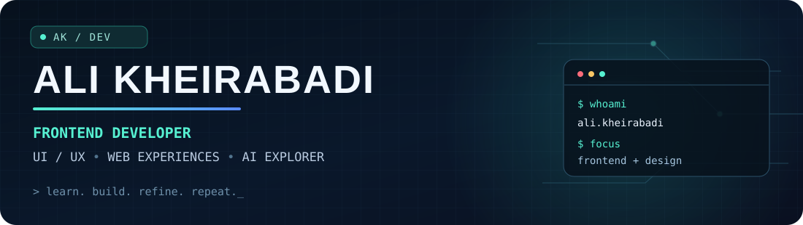

<p align="center">
  
</p>

<p align="center">
  <a href="mailto:alikheirabadi1384@gmail.com"></a>
  <a href="https://linkedin.com/in/Ali"></a>
  <a href="https://t.me/Ali_Kh_Dev"></a>
</p>

<p align="center">
  
</p>

---

### `> whoami`

Hey! I'm **Ali Kheirabadi** — a **frontend-focused developer** and Computer Software Engineering student from Iran.

I enjoy turning ideas and designs into **clean, responsive, and usable interfaces**. My interests sit at the intersection of **frontend engineering, UI/UX, and practical AI**. I care about the little details: spacing, consistency, accessibility, interaction, and how an interface feels across devices.

- 🎯 **Main focus:** Frontend development, responsive dashboards, and UI/UX
- 🧩 **Working with:** HTML, CSS, JavaScript, Tailwind CSS, Git
- 🌱 **Growing into:** React, TypeScript, full-stack development
- 🤖 **Exploring:** LLMs, AI agents, and intelligent energy-management research
- 🚀 **Goal:** Build useful products and grow with ambitious engineering teams

### `> tech_stack --show`

**Frontend & styling**

<p>
  
</p>

**Design & development tools**

<p>
  
</p>

<sub>React and TypeScript are areas I'm actively developing; badges represent tools I've used or am learning, not claimed expert-level proficiency.</sub>

### `> ls featured-work/`

| Work | What it demonstrates | Status |
| :--- | :--- | :--- |
| [Expense Journal](https://github.com/AliKh1384/gleam-expense-journal) | A web-app prototype using React, TypeScript, Tailwind CSS and TanStack tooling | Public · Archived |
| **Responsive dashboard interfaces** | Customer, agent, and business-facing layouts, component styling, and multi-breakpoint UI work | Selected work · Code not public |
| **Autonomous AI for energy management** | Research exploration of intelligent agents for energy optimization | Research in progress |

> Some of my work is private or not ready for a public showcase. I prefer sharing projects with a clear README, screenshots, and a usable demo when possible.

### `> cat current_focus.txt`

```text
[01] Responsive, accessible, polished web interfaces
[02] React + TypeScript and real-world frontend architecture
[03] UI/UX systems, components, and design-to-code workflows
[04] AI agents and their practical applications
```

### `> contact --open`

I'm interested in **frontend opportunities, internships, and thoughtful collaborations**.

- 💌 Email: **[alikheirabadi1384@gmail.com](mailto:alikheirabadi1384@gmail.com)**
- 💼 LinkedIn: **[linkedin.com/in/Ali](https://linkedin.com/in/Ali)**
- 💬 Telegram: **[@Ali_Kh_Dev](https://t.me/Ali_Kh_Dev)**

<p align="center">
  <sub>Build with curiosity. Ship with care. Keep learning.</sub>
</p>
